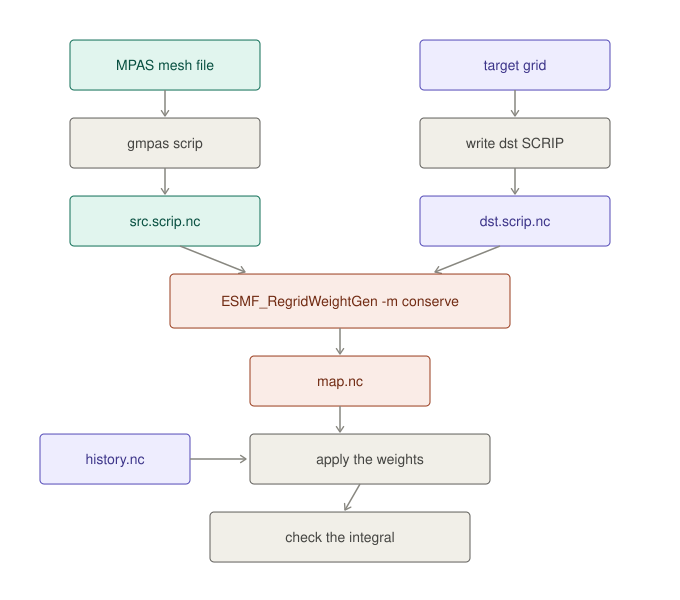

# Conservative remapping

CLI app for remapping (or regridding) MPAS (or any other variable mesh, Voronoi mesh) outputs to conserved lat-lon grids. Conserved remapping is needed for any analysis that uses area or cell averages (e.g. a moisture budget).

## Prerequisites

```bash
pip install gmpas                                  # gmpas itself

# ESMF_RegridWeightGen (required: gmpas runs it to make the weights)
module load esmf                                   
conda install -c conda-forge esmf                  # or

# ncremap (optional: you run it yourself to apply the weights)
module load nco
conda install -c conda-forge nco #or
```


## Workflow




## Example workflow

gmpas remap can be configured using the following files:

- `target_domain` (required) contains target domain (lat-lon) configuration
- `include_fields` (optional) contains the fields that should be remapped to lat lon
- `exclude_fields` (optional) excludes the specified fields 
- `mesh_file` (required).

### target_domain example

```
nlat = 180
nlon = 360
startlat = -90
endlat = 90
startlon = -180
endlon = 180
```

### include_fields example

```
rainc
rainnc
t2m
q2
u10
v10
mslp
```

### exclude_fields example

```
theta
rho
w
pressure_p
```

Then:
```bash
gmpas remap 'history.*.nc' -m mesh.nc -o out/ -j 8
```
> This is imitating the exact behaviour of [convert_mpas](https://github.com/mgduda/convert_mpas) but with conserved remapping and only computing weights once. 

```
[1/3] configuration from /scratch/run
        found   target_domain
        found   include_fields
        absent  exclude_fields
        found   mesh_file
  input : 193 file(s)
  mesh  : init.nc  (from mesh_file)
  target: 534 x 267 cells, lon 80.0 .. 160.0, lat -20.0 .. 20.0, 0.149813 deg
  fields: 20 selected of 119 available

[2/3] weights
  writing src.scrip.nc and dst.scrip.nc
    normalised 12,774 longitudes onto [0, 2pi)
  weights ready in 18.2 s (77 MB)

[3/3] remapping 193 file(s) -> out/
        not remapped — u: on nEdges — needs edge weights
        conservation error 0.0e+00 (0 is exact)
  [  1/193] history.2012-02-25_00.00.00.remap.nc  18 fields, 347 slabs, 5.7s, eta 18m
```


> `--mesh` can be skipped if you already have the mesh information

`mesh_file` is usually the right answer for a real run — set once, not passed
on every command.

### What cannot be remapped by using gmpas remap
 - variables on edges or vertices
 - when mesh information is absent

```
        not remapped — u: on nEdges — needs edge weights
        not remapped — vorticity: on nVertices — needs vertex weights
```

### Notes on parallel runs

The current gmpas version only supports parallelism by file, so `-j 64` is only efficient if you have more than 64 files. In future, per-variable workers will be implemented. 

Try:
```bash
gmpas remap 'history.*.nc' -o out/ -j 64
```

> We recommend giving **`-j` explicitly.** 

Expected behaviour
```
  64 worker(s) (of 64 from SLURM_CPUS_PER_TASK)     detection worked
```
In some compute nodes 

```
1 worker(s) (of 1 from NCPUS)                     detection was misled
```

With `-j` given explicitly:
```
  64 worker(s) (asked for 64; 1 available from NCPUS)
```

## gmpas remap (all steps)


### 1. Write the source grid

```bash
gmpas scrip history.2012-02-25_12.00.00.nc -o src.scrip.nc
```

Works on any file carrying mesh information — an `init.nc`, a `*.grid.nc`, or
a history file that carries its own mesh. 

### 2. Write the target grid

Describe it in a `target_domain` file beside the run:

```
nlat     = 267
nlon     = 534
startlat = -20.0
endlat   =  20.0
startlon =  80.0
endlon   = 160.0
```

`startlat`/`endlat` are the **domain edges** and `nlat` counts cells across
them, so the spacing is `(endlat - startlat) / nlat` and centres sit half a
cell inside each edge — the grid then covers exactly the box you asked for.

The extent is not fussy beyond that. Target cells falling outside the source
mesh come back unmapped, and a target narrower than the mesh simply crops.

Then,

```bash
gmpas target -o dst.scrip.nc
```

or,

```bash
gmpas target history.2012-02-25_12.00.00.nc -o dst.scrip.nc
```

Cell areas are written as exact solid angles, `dlon x (sin(north) -
sin(south))`.

`ncremap -g dst.scrip.nc -G latlon=180,360` will also generate a target but with ncremap (without gmpas)

### Notes on include or exclude_fields


- Blank lines and `#` comments are ignored
- If both include_fields and exclude_fields exist, exclude_fields is ignored entirely.

## Without gmpas: ESMF and ncremap

With `src.scrip.nc` and `dst.scrip.nc` from steps 1 and 2:

```bash
# weights, once per mesh pair
ESMF_RegridWeightGen -s src.scrip.nc -d dst.scrip.nc -w map.nc \
    -m conserve --src_regional --dst_regional --ignore_unmapped
ncremap -s src.scrip.nc -g dst.scrip.nc -m map.nc -a aave     # or, with ncremap

# apply them to each file
ncremap -m map.nc history.nc remapped.nc
```

- `--src_regional` / `--dst_regional`: for a mesh that does not cover the sphere
- `--ignore_unmapped`: target cells outside the mesh are left unmapped instead of failing
- `-m conserve2nd`: second order, less diffusive
- make the source grid with `gmpas scrip`: it fixes mixed longitude ranges and
  padded `grid_corners`, which break ESMF and `mpas_tools`

Measured on a 413,788-cell regional mesh to a 0.25° lat-lon grid:

:::{table} Relative error before and after remapping using gmpas remap
| field | relative error |
|---|---|
| constant 1.0 | 1.1e-16 |
| smooth analytic (float64) | 0.0 |
| `precipw`, `t2m` | 0.0 |
| nearest-neighbour, for contrast | 2.1e-05 |
:::

```{math}
\text{relative error} = \frac{|I_{dst} - I_{src}|}{|I_{src}|}, \qquad
I_{src} = \sum_{\text{MPAS cells}} f \, A \, \mathit{frac}, \qquad
I_{dst} = \sum_{\text{lat-lon cells}} f \, A
```
