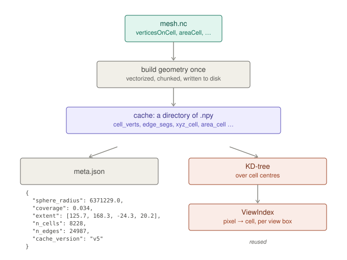
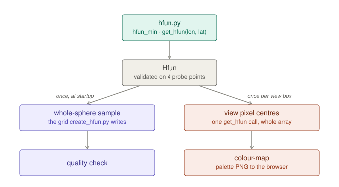
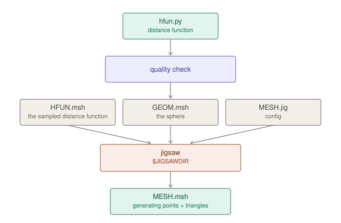

# Preprocessing

`gmpas prep` is the CLI tool for MPAS mesh preprocessing.

| command | what it does |
|---|---|
| `gmpas prep view mesh.nc` | browse a mesh, cells coloured by width |
| `gmpas prep hfun hfun.py` | distance function viewer |
| `gmpas prep generate hfun.py -o mesh/` | build a mesh with JIGSAW |
| `gmpas prep scale mesh.nc --scale-factor 2` | scale a mesh (scale_region.py) |
| `gmpas prep relocate mesh.nc --tan-lat 40 --tan-lon 280` | move the refinement (grid_rotate.py) |
| `gmpas prep create-region mesh.nc --polygon ...` | global to regions (create_region.py) |

## Browsing a mesh

```bash
gmpas prep view mesh.nc
```

```
8,228 cells, 24,987 edges, regional — cell width 43 to 68.1 km
listening on 127.0.0.1:8765 — this machine only
```



## Distance function

Distance function `hfun.py` is a Python file that defines the minimum cell width and a function to get the cell width at any point on the sphere. It is used to guide mesh generation and refinement. (See the [MPAS JIGSAW tutorial](https://github.com/mgduda/mpas_jigsaw_tutorial).)

```bash
gmpas prep hfun hfun.py            # use the viewer to visualise the distance function
gmpas prep hfun hfun.py --check    # Check the mesh quality from distance function
```

```
hfun.py: hfun_min 12 km, grid distance 12 to 60 km
max cell size gradient 0.0300 at 75.64, -95.05 (within the 0.03 guideline)
```



- `hfun.py` defines `hfun_min` (km) and `get_hfun(lon, lat)` (radians in, km out),
  as in the [MPAS JIGSAW tutorial](https://github.com/mgduda/mpas_jigsaw_tutorial).
- Keep the maximum gradient at or below 0.03.
- Fields: `cell_width_km` and `mesh_density`.

## One server for run, mesh and distance function

```bash
gmpas view /path/to/run/ --hfun hfun.py     # data + mesh + hfun
gmpas prep view mesh.nc --hfun hfun.py      # mesh + hfun
gmpas prep hfun hfun.py --mesh mesh.nc      # hfun + mesh
```

One port, one tunnel; each page has a switcher.

## Generating a mesh

**Prerequisites**:

1. `conda install -c conda-forge jigsaw`
2. `conda install -c conda-forge openmpi pnetcdf` (or: `module load openmpi pnetcdf`)
3. `git clone https://github.com/mgduda/mpas_jigsaw_tutorial.git` (for `mkgrid.c` and hfun examples)
4. build `mkgrid` in that clone: `export PNETCDF=$CONDA_PREFIX; make` (this will be replaced with an inbuilt mkgrid in the future)

```bash
export JIGSAWDIR=/path/to/jigsaw/build/src            # or .../bin
export MKGRIDFILE=/path/to/mpas_jigsaw_tutorial/mkgrid
gmpas prep generate hfun.py -o mesh/
```



```
  hfun_uniform.py: 120 to 120 km, max gradient 0.0000
  running jigsaw — this is the slow part
  MESH.msh: 41,225 generating points, 82,446 triangles in 37.4 s
  running mkgrid 120000 (nominalMinDc in metres = hfun_min * 1000)
  grid.nc: 41,225 cells (49 MB) in 0.4 s
```

- A gradient above 0.03 stops the run; `--allow-steep` builds it anyway.

| flag |  |
|---|---|
| `--skip-mkgrid` | stop after JIGSAW; `mkgrid` not needed |
| `--init` | initial points (icosahedral structure for a quasi-uniform mesh) |
| `--qlim` | JIGSAW's mesh-quality limit |
| `--force` | rebuild `MESH.msh` and `grid.nc` |
| `--allow-steep` | build despite a steep gradient |

## Rescaling a regional mesh (scale_region.py)

```bash
gmpas prep scale mesh.nc --scale-factor 2.0 --tan-lat 0 --tan-lon 125 -o scaled.nc
```

- `--scale-factor` above 1 makes cells finer, around the tangent point.
- Regional meshes only: far from the tangent point the scale drifts, and past
  about 120° it makes cells coarser. gmpas warns beyond 45°.
- Unit-sphere meshes only (straight from `prep generate`, before `init_atmosphere`).
- Writes a before/after plot (`--plot-out`, `--no-plot`). The input is never changed.

## Moving a refined region (grid_rotate.py)

```bash
gmpas prep relocate mesh.nc --tan-lat 40 --tan-lon 280 -o relocated.nc
```

- A conserved rotation of the cells: cell sizes and areas are unchanged. Works on global meshes.
- The current centre defaults to the finest cell; `--from-lat` / `--from-lon` set it.

## Cropping a global mesh to a region (create_region.py)

```bash
gmpas prep create-region mesh.nc --polygon 40,-129 50,-129 50,-65 40,-65 -o conus.region.nc
gmpas prep create-region mesh.nc --pts manus.pts
```

**sample points file**

```
Name: Manus
Type: circle
Point: -2.0, 147.0
radius: 3000000.0   # Meters
```

- `--polygon`: `lat,lon` pairs, at least 3. `--point` names a point inside
  (default: the centroid; pass it for a concave region).
- `--pts`: MPAS-Limited-Area's format; `custom`, `circle` and `ellipse` are supported.
- Adds the 7 boundary rings MPAS needs (`bdyMaskCell` 1–7) and writes
  `graph.info` and a PNG of the zones (`--no-plot` to skip).
- Prefer a convex region: a concave one can give wrong terrain in `init_atmosphere`.

## References

1. [MPAS JIGSAW tutorial](https://github.com/mgduda/mpas_jigsaw_tutorial)
2. [MPAS tutorial](https://www2.mmm.ucar.edu/projects/mpas/tutorial/)
3. [MPAS-Limited-Area source code](https://github.com/MiCurry/MPAS-Limited-Area)
4. [MPAS tools](https://github.com/MPAS-Dev/MPAS-Tools)
